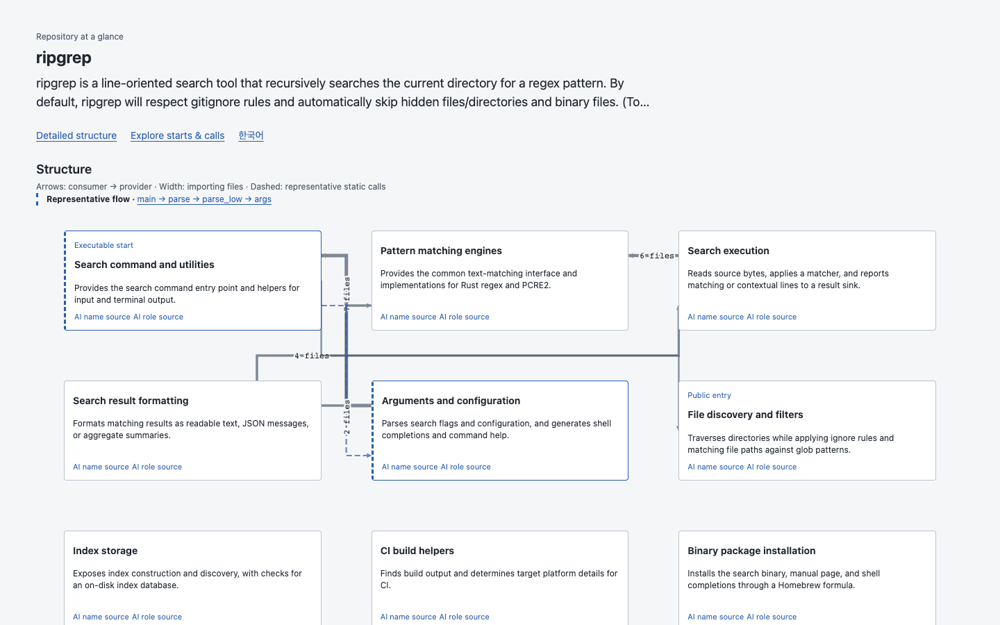

# Lattice

Understand an unfamiliar repository through its components, dependencies, entrypoints and source-backed call paths.



```sh
npx --yes https://github.com/hyunlord/lattice/releases/download/v0.1.0-l11/hyunlord-lattice-0.1.0-l11.tgz open /path/to/repository
```

Node20+ and Git are required. The command installs the [published L11 prerelease](https://github.com/hyunlord/lattice/releases/tag/v0.1.0-l11); the unscoped npm name `lattice` belongs to another project. Public GitHub repository URLs also work. `--no-browser` prints the local address for remote/headless sessions. No lens, model key or target installation is required; analysis does not run repository code.

[Open the public demo gallery](https://hyunlord.github.io/lattice/) — six public repositories, no setup.

## Start with the structure

The first screen summarizes purpose, dependency-based components, starts, representative static flows and the technology stack. Large inputs show actual discovery progress and a partial inventory before the complete analysis is ready. Open the detailed map, functions and source evidence when you need them.

Descriptions come from repository documentation, manifests and clearly labelled source inventories. Optional external-agent summaries must cite fresh source lines. Static calls describe resolvable code relationships, not observed execution or complete dynamic dispatch.

## Why this approach

- **Trace claims to code.** Follow source paths and line references; graph identities and source hashes make stale interpretations visible.
- **Keep the map current.** Watch local source changes or use the reusable GitHub workflow for automatic maps and PR differences.
- **Give agents the same facts.** MCP exposes the same graph, entrypoints, callers and bounded flows as the viewer.

[GitDiagram](https://github.com/ahmedkhaleel2004/gitdiagram) also offers source navigation and MCP. Those capabilities are not unique to Lattice. Lattice's specific choice is a deterministic, inspectable graph and conservative static analysis before optional generated prose; no model is required to open a repository. See the [evaluation protocol](docs/benchmarks/l11/protocol.md) for the comparison method and its limits.

## Explore and contribute

- [Usage, lenses, MCP and automation](docs/guide.md)
- [Architecture](docs/design/lattice-v0.md), [design system](DESIGN.md) and [contributor contract](AGENTS.md)
- [L11 frozen public corpus and questions](docs/benchmarks/l11/questions.json), [evaluation and unmet targets](docs/benchmarks/l11/evaluation/evaluation-report.md), and [public delivery](docs/benchmarks/l11/publication/README.md)
- [Earlier acceptance evidence](docs/review/acceptance.md) and accepted [L10 performance residuals](docs/benchmarks/l10/closure-display.md)
- [Domain lens example: bs-mobile](https://hyunlord.github.io/bs-mobile/) — a configured example, separate from the generic product gallery

Development: `npm ci --ignore-scripts`, `npm run check`, `npm run test:package`. CI checks Node20,22 and24. MIT licensed.
