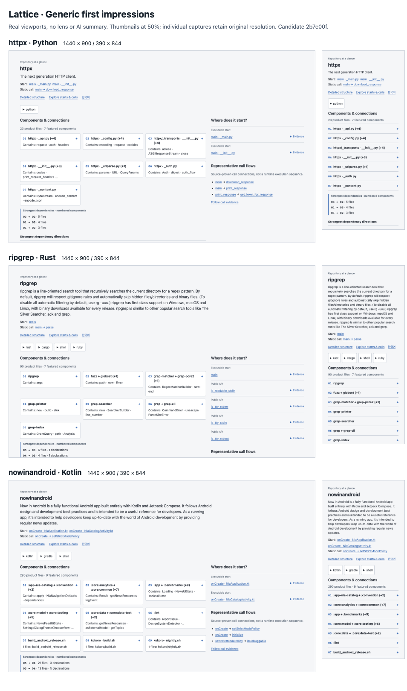

# L11 delivery evidence

The original [HTTPX1440](screens/httpx-1440.png), [HTTPX390](screens/httpx-390.png), [ripgrep1440](screens/ripgrep-1440.png), [ripgrep390](screens/ripgrep-390.png), [Now in Android1440](screens/nowinandroid-1440.png) and [Now in Android390](screens/nowinandroid-390.png) are actual browser viewports, without a lens or AI summary. The [manifest](screens/manifest.json) binds their dimensions and hashes to candidate`2b7c00f`. The subsequent`940b23c` patch changes only the early loading shell and its regression tests; the completed summary model and these views are unchanged.

## Browser and implementation checks

The three pinned sources were freshly extracted and exported, not overlaid onto an earlier graph. Eight captures, including two additional Korean views, recorded zero browser errors, horizontal overflow and initial whole-graph requests. At390px the fully visible component headings numbered7,6,7 respectively; remaining content is scrollable, not removed. Mobile controls measure at least44px. Actual list→detail→back→map navigation passed. Two independent visual reviewers inspected the final captures. These are interface checks, not a human30-second comprehension score.

Independent code review verified actual manifest dependency projection and packed HTTP access for arbitrary layer identifiers. Independent security review exercised malicious Git clean/process filters and confirmed that read-only `open`, including interpretation reads, did not execute them. Invalid/stale/uncited generated claims fall back to deterministic text; mechanically valid citations do not establish semantic entailment.

Candidate`2b7c00f` passed1,253 tests and installed-package checks, with Node20/22/24 CI. The follow-up`940b23c` fixed a missing favicon and raw README markup in the partial inventory; seven focused tests and real Chrome1440/390 checks passed. Initial404 observations remain in startup evidence. A fixture-based progress-screen pass does not imply successful large-repository completion.

## Large-input limitation

On the frozen runtime repository (58,427 tracked files), actual source inventory appeared at1.266s, but no complete map was available at the20-minute deadline. The process was intentionally stopped; orderly exit0 is not a success. Sampled peak summed CLI-tree RSS was4.478GB (10,987samples; maximum sampling gap16.541s). The source stayed unchanged. A second full cold390px trial was prospectively marked N/A. Diagnosis remains open in [#102](https://github.com/hyunlord/lattice/issues/102); the broad export-phase timestamp does not identify the slow operation.

## Distribution boundary

The unscoped npm package `lattice` is owned by another project. This delivery uses a versioned GitHub Release tarball invocation rather than claiming that name or requiring unavailable npm credentials. The package provides the `lattice open` binary. A release link is usable only after publication and an installed-command smoke check.

The public gallery is Lattice's own site with six non-game repository examples. The configured game map remains a separately labelled lens example. Consumer sources and Charter & Kin were not modified. GitDiagram's public documentation was accessible, but matching diagrams for the frozen source revisions were not verified; the optional comparative arm is N/A, not zero.

Installed-package timings and preserved failures are recorded in [startup.md](startup.md) with [machine-readable observations](startup.json). Comparative scores and publication verification remain separate; no pending result in this document is a pass.

The actual six-map gallery passed twelve first-screen checks for language, pinned source links, browser errors, overflow and deferred graph loading. QA found and fixed local-clone source URLs, gallery hash-route language selection, long partial-inventory manifest paths, and expanded mobile evidence hashes. After the one-rule evidence wrapping fix, all twelve expanded views had zero overflow/errors and retained exact source text. These failures remain in the local QA artifacts; corrected views do not erase the initial observations.

## Final implementation checks

Candidate`43b2710` passes1,259 tests on [Node20/22/24 CI](https://github.com/hyunlord/lattice/actions/runs/38364215491), [installed-package CI](https://github.com/hyunlord/lattice/actions/runs/38364215471) and [documentation contracts](https://github.com/hyunlord/lattice/actions/runs/38364215412). Independent scope review found no new domain specialization, added dependency, model/API core path or target-build execution. The stale L10-only guide introduction was updated while preserving its historical acceptance.

The final summary citation correction retains the immutable source URL and adjusts its line fragment after narrowing a README range; focused extraction checks produce `#L28` and `#L13-L16` for the two observed failures. The frozen2b7c00f evaluation keeps the original behavior and is not rerun with the repair. Public generation and exact-link checks are still required before declaring publication verified.

## Frozen comparison verdict

All36 trials and independent grades are complete. [The18-repository table](evaluation/evaluation-report.md) retains original answers, grades, timing bounds and availability failures. GitHub-direct scored324/360(90.00%); map plus source scored318/360(88.33%). Accuracy non-inferiority fails by6points. The17 coordinator-timed pairs took3821.25–4127.71s direct and4205.04–4451.96s with the map:1.019–1.165times as long, missing the50% reduction target. Click direct has only a300-second self-report, so the strict18-repository primary timing aggregate is unavailable; the supplemental substitution is explicitly separate.

L11 is therefore **partial, not accepted**: implementation and medium startup checks pass; measured task benefit does not. Issue#100 remains open, alongside the large-input failure#102. No answer was rerun with the later release fixes. Public release/gallery checks are the remaining delivery work, not a replacement comprehension test.
