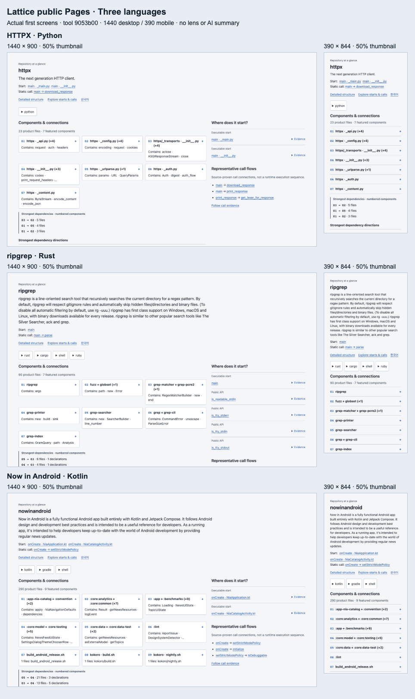

# Verified public delivery

[HTTPX1440](screens/httpx-1440.png) / [390](screens/httpx-390.png), [ripgrep1440](screens/ripgrep-1440.png) / [390](screens/ripgrep-390.png), [Now in Android1440](screens/nowinandroid-1440.png) / [390](screens/nowinandroid-390.png). The sheet uses50% thumbnails of actual1440×900 and390×844 first screens. [Capture identities](screens/manifest.json) bind the images to the public deployment.

- [Public gallery](https://hyunlord.github.io/lattice/): six non-game pinned repositories, with the configured game map linked separately as a lens example.
- [Merged PR101](https://github.com/hyunlord/lattice/pull/101), tool commit`9053b00db1ca24f4f7e8ea12be0ae5e115368303`; [required PR CI](https://github.com/hyunlord/lattice/actions/runs/38368431266),1,259 tests on each of Node20/22/24; [Pages build/deploy](https://github.com/hyunlord/lattice/actions/runs/38368804790).
- [Actual public-browser results](gallery-checks.json):12 first screens and12 expanded-evidence views, zero console/HTTP errors, overflow or initial whole-graph requests. All six source commits match the gallery manifest; narrowed purpose links match their cited line ranges. Gallery navigation was exercised through its actual links. These checks do not establish human comprehension.
- [Published prerelease](https://github.com/hyunlord/lattice/releases/tag/v0.1.0-l11): the tarball is540,195bytes; exact digest in[release.json](release.json). The npm name`lattice` is not owned by this project, so the documented command uses the public tarball URL.
- [Actual public-URL installation](release-smoke.json): a new npm cache, local pinned HTTPX source, real headless Chrome; listener7.10s, completed map8.95s including tool installation and browser launch. Source commit and Git status match, no overflow/browser errors. This operational smoke is not a medium-repository benchmark or a new evaluation trial. The earlier installed native-browser launch was tested separately.

L11 remains **partial**. [Frozen task evaluation](../evaluation/evaluation-report.md) misses both accuracy non-inferiority and50% time savings;#100 remains open. The58,427-file full-map timeout remains#102. Neither publication nor passing interface checks changes those verdicts.
