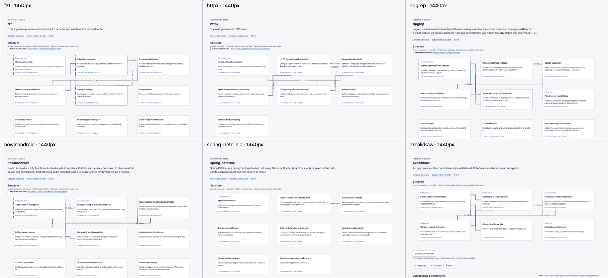
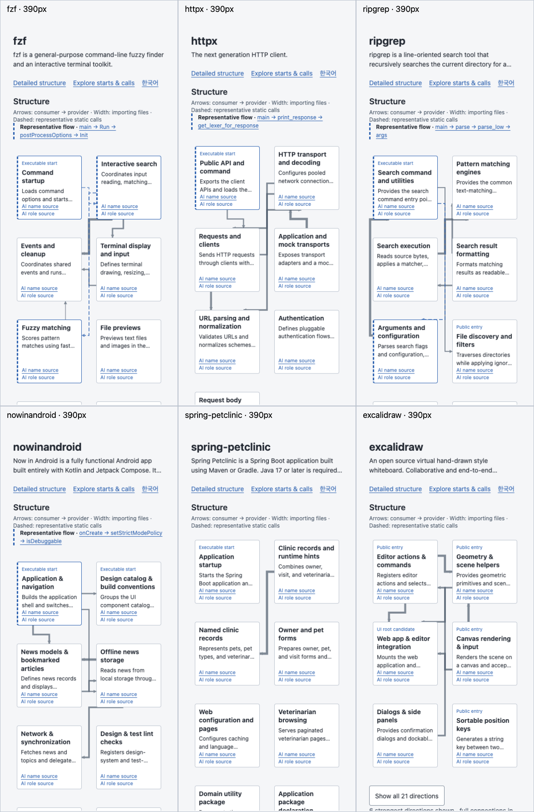

# L12 implementation and pre-publication verification

The implementation is ready for the registered human test, subject to public Pages verification recorded in [issue #104](https://github.com/hyunlord/lattice/issues/104). **Usefulness remains unjudged.** The registration-time publication statuses in repositories.json are historical, not live availability checks. No answer key or user-test preview is included here.

| Gallery | Featured components | Available / initial dependency directions | First-screen flow evidence |
| --- | ---: | ---: | --- |
| fzf | 9 | 6 / 6 | Confirmed call path |
| httpx | 7 | 24 / 6 | Confirmed call path |
| ripgrep | 9 | 9 / 6 | Confirmed call path |
| nowinandroid | 9 | 14 / 6 | Confirmed call path |
| spring-petclinic | 8 | 1 / 1 | Main entry only |
| excalidraw | 6 | 21 / 6 | UI / package alternatives |

Actual repository-neutral diagrams precede prose. Six strongest dependency directions appear first; expanding preserves all directions. Arrow width scales with importing-file counts. Exact counts are in the complete list and desktop hover text; a desktop count label is omitted if no collision-free place exists, and mobile omits count labels. Dense routes can still share rails. Mobile roles are abbreviated; component buttons open full text, members and evidence. These are disclosed presentation limits, not a claim of human comprehension.

## Changes and verification

- Generic first-impression projection, viewer, interpretation/MCP context and init instructions changed; source-bound gallery notes live under examples/gallery. Canonical graph relationships remain separate from preview grouping and bounded path selection. Repeated callsites no longer consume the entire flow preview.
- 76 external-agent notes provide 152 validated name/role claims. Complete membership hashes and exact source excerpts are checked. This verifies citation integrity/freshness, not automatic semantic entailment; source-based authoring and separate sample review supply the interpretation check. No model/API was embedded and no dependency added.
- `npm run check`: **1278/1278**, typecheck, formatting, documentation and benchmark-specialization guard passed. `npm run test:package` passed. Local Node 25.8.2; required Node 20/22/24 CI remains a separate merge gate.
- Real headless Chrome at 1440×900 and 390×844: **18/18** maps load with exact registered source pins, zero browser/HTTP errors, horizontal overflow, initial full-graph requests, count-label collisions or box clipping. Keyboard component buttons open details; expansion does not overflow. Gallery root exposes six entries, excluding the three direct-link user tests.
- Independent browser checks exercised confirmed flow navigation and the UI fallback destination. The latter opens the actual source module with its imports instead of an empty anonymous-function panel. HTTP(S)-only evidence links and positive numeric MCP startLine have boundary regressions.
- Earlier label collisions, saturated line widths, disconnected flow snippets, numeric MCP rejection and unsafe source-link schemes were found and fixed before publication. Local failed captures remain outside the checkout; final screens above represent the corrected candidate.
- These are desktop-browser mobile emulation and static-analysis checks, not real-device measurements or observed application execution. Petclinic has no confirmed representative call flow; Excalidraw's UI/package alternatives are explicitly not confirmed execution sequences.

## Reproduce

```sh
npm ci --ignore-scripts
npm run check
npm run test:package
node tools/build-gallery.mjs --manifest examples/gallery/repositories.json --output /tmp/l12-site --sources /tmp/l12-sources-repro --cache /tmp/l12-cache-repro
python3 -m http.server 8186 --bind 127.0.0.1 --directory /tmp/l12-site
```

Capture each registered gallery at 1440×900 and 390×844 with touch/mobile emulation on 390; use `#/home?lang=en`. Assertions and source pins are recorded in [browser-checks.json](browser-checks.json). Initial timings are single local smoke observations, not a controlled speed comparison. The three user-map captures stay private to prevent pre-exposure.

## Human gate remains pending

Use the [five-minute worksheet](worksheet.ko.md): Lattice first, save answers, then inspect DeepWiki/README. Questions were frozen at d33ea73 before target inspection or product changes. Timings and accuracy are descriptive because repeated exploration has a learning effect. The user alone answers whether they would choose Lattice instead of DeepWiki next time; fewer than two yes answers among the three selected repositories stops new features and retains MCP/CI-diff maintenance. Reference keys remain private until all tests finish. Issues #100/#102 remain open and out of scope. The public gallery gets L12; the existing install command still selects the explicitly labelled L11 prerelease.
