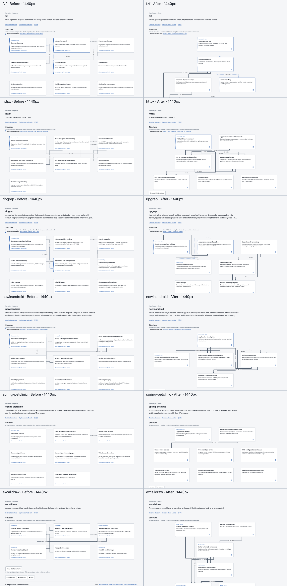

# L12 pre-test diagram polish

Issue #107; human evaluation remains open in #104. The comparison baseline is `e11f813b435651e424759680129f44d89b8484cc`. Repository revisions, external-agent claims, frozen questions and private answer keys are unchanged.

Dependencies now determine layers, with consumers above providers and mutually dependent components sharing a rank. A bounded crossing-reduction pass orders each layer; separate edge ports and channels retain each displayed direction. Count labels have solid backgrounds and arrowheads terminate at component boundaries. Dense expansions can still contain perpendicular crossings, and tall diagrams require scrolling; no claim of universally crossing-free layout is made.

Auxiliary-only components are folded into **Tools & configuration**. Classification examines every member path, preserving mixed product/tool components and root product-source directories. The underlying graph, membership and evidence remain available. One evidence icon per diagram card opens the existing source-backed name and role details. No dependency, model integration, repository-specific branch or consumer change was added.

## Verification

`npm run check` passes 1,289 tests plus type, format, documentation and benchmark-contract checks. `npm run test:package` passes. Browser checks exercise desktop 1440×900 and touch-emulated 390×844, source pins, product filtering, collapsed tools, directed routes, readable counts, evidence keyboard activation, horizontal overflow and browser errors. All 18 repository/viewport checks passed with zero browser errors, horizontal overflow, shared collinear arrow segments or physically clipped role lines. Independent visual review of all twelve gallery captures passed after fixing the badge/footer clipping. These are local Chrome checks, not physical-device or human usefulness results. Publication evidence is recorded in the issue after CI and Pages complete.

The six comparisons below use identical source revisions and 1440×900 viewports. Only the six public gallery repositories are captured; the three user-test repositories and answer keys are not exposed. Human acceptance is pending the registered five-minute test.

## Before and after

- [fzf](polish-screens/fzf-before-after-1440.png)
- [HTTPX](polish-screens/httpx-before-after-1440.png)
- [ripgrep](polish-screens/ripgrep-before-after-1440.png)
- [Now in Android](polish-screens/nowinandroid-before-after-1440.png)
- [Spring Petclinic](polish-screens/spring-petclinic-before-after-1440.png)
- [Excalidraw](polish-screens/excalidraw-before-after-1440.png)
