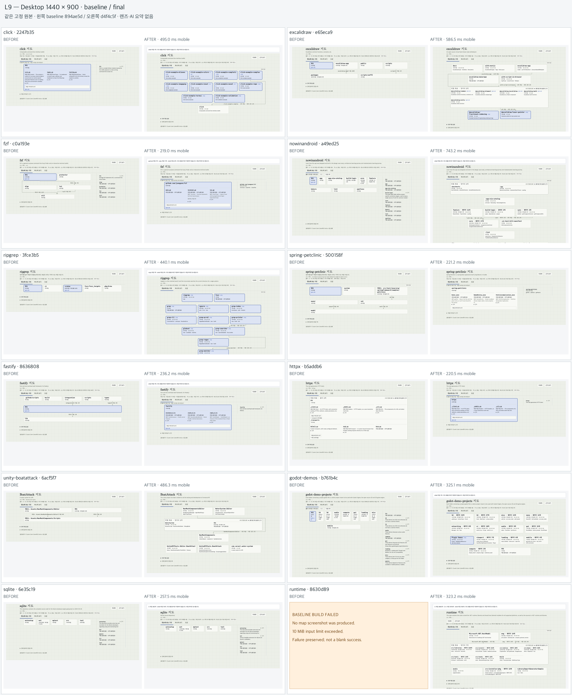
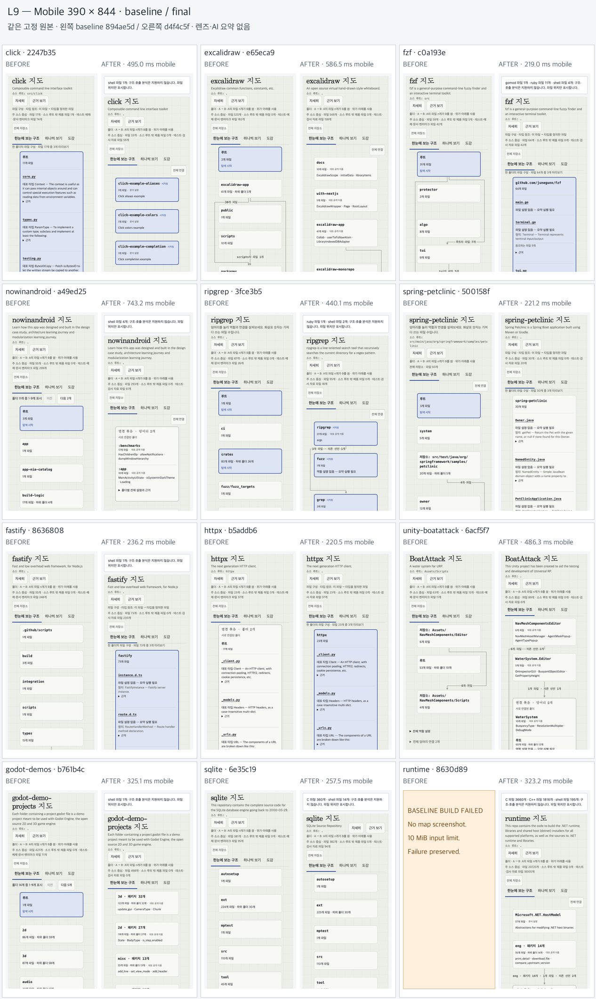

# L9: package and logic maps

관문: 부분 — 수치 관문과 정적 사이트 검증은 통과. 최종 블라인드71/96 대 소스93/96. 실제live 검증도 통과했으며 소비자 게시는[bs-mobile#228](https://github.com/hyunlord/bs-mobile/issues/228)에서 병합 후 추적한다. 호출 재현과 대형 MCP 응답 시간의 한계는 아래에 명시한다.

같은 고정 원본에서 기준선894ae5d와 최종 분석·화면d4f4c5f를 비교했다. 이후380d163은 검사·문서 변경이다.29b1e9c는 live 생성 작업만 worker로 옮겼으며 분석·정적 화면 파일은d4f4c5f와 바이트 단위로 같다. runtime 기준선은 빌드 실패 패널을 보존한다. [화면·원본·그래프 해시](l9-media/provenance.json), [사전 고정 질문과 측정 방법](../benchmarks/l9/README.md).

| 저장소 | 모바일 첫 표시 ms | 제품 파일 포함 | 내부 패키지 의존 | 제한 호출 표본: 확정+추정/분모 | 지도·MCP / 소스 점수 |
|---|---:|---:|---:|---:|---:|
| click |495.0|32/32|N/A|1+0/1|6/8 / 8/8|
| excalidraw |586.5|549/553|10/10|0+0/0|5/8 / 7/8|
| fzf |219.0|60/60|N/A|4+0/4|7/8 / 8/8|
| nowinandroid |743.2|196/196|116/116|1+1/5|4/8 / 8/8|
| ripgrep |440.1|92/92|18/18|3+0/5|6/8 / 8/8|
| spring-petclinic |221.2|30/30|N/A|0+2/2|5/8 / 8/8|
| fastify |236.2|73/73|N/A|4+0/5|7/8 / 8/8|
| httpx |220.5|23/23|N/A|0+0/0|7/8 / 8/8|
| unity-boatattack |486.3|84/84|2/2|3+0/5|6/8 / 7/8|
| godot-demos |325.1|496/496|N/A|0+0/0|6/8 / 8/8|
| sqlite |257.5|363/372|N/A|0+0/0|6/8 / 7/8|
| runtime |323.2|19570/19897|4782/4859|0+2/5|6/8 / 8/8|

제품 포함률97.58–100%로 승인한90%를 넘는다. 접힌 패키지 내부 파일을 포함하며 분모 없는 항목은100%로 바꾸지 않는다. Gradle은 실제 구성 평가116쌍/124scope, MSBuild는 조건을 보존한 소스 선언4859개 중4782개(98.42%)이다. MSBuild를 평가된 구성의 활성 의존이라고 주장하지 않는다.

확정 호출은 사전 고정 추출 규칙으로 새 표본을 먼저 고정한 뒤 전체 호출자와 대상을 검증해50/50이었다. 독립 교차검사는50개 호출자와12개 대상을 확인했다. 제한된 별도 소스 표본의 재현은 **확정16/32(50%), 추정 포함21/32(65.63%)** 이며 전체 프로그램 재현율이 아니다. Java/C#/Kotlin에서 실행 대상을 확정할 수 없는 인스턴스 메서드는 추정으로 남기고 기본 흐름에서 제외한다. C/C++ 호출 분석은 미지원이다.

첫 화면은 Chromium1440×900 CPU1배,390×844 CPU4배, 새 컨텍스트3회 모바일 중앙값으로 측정했다. 로컬 gzip 서버이며 인위적인 네트워크 감속은 없다. 최종12개48회에서 오류·가로 넘침0이다. 별도11개 자연 탐색89단계도 오류·HTTP 실패·가로 넘침·전체 그래프 요청0으로 통과했다. 이는 실제 이동통신 환경이나 사람의30초 이해성을 증명하지 않는다.

대형 원본58,427파일의 빈 캐시 빌드 **266.056초**, 기본 Node heap, 재사용0, 최대RSS5.712GB로300초 관문을 통과했다. 환경은 Apple M4 Max14CPU/36GiB/Node25.8.2다. 전체 export는 **474.151초·12.971GB·1,557,918파일**로 별도 작업이다. 상세 패킷 최대256KiB이나 전체 사이트가 작다고 주장하지 않는다.

실제 `serve`는 준비 완료까지691.012초(명령 내부686.531초)가 걸렸다. 이력과 상세 산출물을 생성하는 시간이며 별도로 기록한다. 캐시 입력45,788개 중45,778개 재사용·10개 분석, 원본·그래프 해시는 정적 사이트와 일치했다. 실제 브라우저 기능과 변경 없는 검사19회는 통과했지만 상세8290ms·관계 다음 페이지2628ms로 정적 사이트보다 느렸다. 같은 전송량의 대조 실험에서 동기 원본 검사가 HTTP 응답을 막는 원인임을 확인했다.29b1e9c에서 생성 작업을 worker로 옮겼으며 수정 후 실제 대형 재측정은 다음 문단에 별도로 기록한다. 기존 실행의 live 반응성을 통과로 처리하지 않는다. 서버는 종료 이벤트를 남기고 포트를 닫았으나, 검증 도구가 대량 파일 정리를30초 뒤 강제 종료했다. 이 실행의 프로세스 정상 종료·정리는 미확인으로 보존한다.

수정 후29b1e9c의 실제 `serve` 준비는747.938초였다. 기본 힙과 엄격한 원본 관찰을 유지했고 분석·정적 화면 파일과 그래프 해시는 기존d4f4c5f와 같았다.390폭·CPU4배 실제 브라우저에서 첫 표시489ms, 상세 **8290→1010ms**, 관계 다음 페이지 **2628→67ms**, 최대TTFB1.7ms를 확인했다.12개 상자·5노드 흐름·선택·상세·근거·이력·이웃·뒤로 가기 모두 통과했고 오류·가로 넘침·전체graph 요청0이었다. 최대DOM long task240ms와 긴 초기 준비 시간은 남는다. 변경 없는 검사1→11회 동안 빌드·세대는1로 유지됐고 오류는 없었다. 정상exit0, 캐시 잠금·생성 디렉터리·프로세스·TCP 포트 제거와 원본 무변경을 확인했다. 전체 실행968.999초는 준비·브라우저·종료 정리를 합친 값이며 종료 시간만을 뜻하지 않는다. 최대RSS는6.333GB다.

대형 첫 화면은 전송172,432바이트·디코딩598,595바이트, overview 자체92465바이트다. 전체 graph/layer 요청 없이 펼침·페이지·선택·5노드 흐름·도감·상세·근거·이력·뒤로가기를 실제로 확인했다. 상세1025ms·최대 long task262ms가 남고, 모바일에서는 주요 영역을 보려면 스크롤해야 한다. 최종 MCP 첫 응답161.998초, 이후 웜 응답5.418–12.177초로 웜1초 목표는 미달이다. 첫 화면 전송량과 별개로 기록한다.

새5개 블라인드 평가와 정본 그래프·소스·선택 화면이 동일한6개 답안, 새 대형 평가6/8을 합쳐 최종12개는 **71/96, 소스 비교군93/96**이다. 대형 답안은 최초 질문 열람부터 파일 기록까지405.349초로600초 이내였다. HTTP16건 모두200, 저장된14개 응답 해시 일치를 확인했고 후처리 오류1건의 복구 기록을 보존했다. 점수 합격선을 새로 만들거나 에이전트 차이를 코드의 인과 효과로 해석하지 않는다. 실행 흐름 답변의 불완전성은 호출 정밀도 통과와 별개다.

기존380d163의570개 검사, Node20/22/24 [CI](https://github.com/hyunlord/lattice/actions/runs/38142524751), [설치 패키지](https://github.com/hyunlord/lattice/actions/runs/38142524705), [불변 질문·범용성 계약](https://github.com/hyunlord/lattice/actions/runs/38142524729)이380d163에서 통과했다. 구현은 매니페스트·언어 규칙을 사용하며 저장소별 분기를 금지한다. `click` 표준 API 예외만 AST 위치로 좁혔다. AI 요약은 외부 에이전트의 선택 기능이다. 후속29b1e9c는578개 검사, Node20/22/24 [CI](https://github.com/hyunlord/lattice/actions/runs/38146734447), [실제 설치 패키지](https://github.com/hyunlord/lattice/actions/runs/38146734282), [계약 검사](https://github.com/hyunlord/lattice/actions/runs/38146734293)를 통과했다. 대형 live 브라우저 재측정과 정상 종료도 위 결과로 검증했다.

## 과거 실패·후보별 증거

아래 기록은 해당 후보 당시의 결과다. 최종 결과는 위 표를 따르며 이전 실패를 소급해 성공으로 바꾸지 않는다.

기존 판정의50/50은 대상만 검사한 값이므로 관문 통과 주장을 철회한다. 동일한 고정 표본에서 호출자와 대상을 모두 검사한 결과47/50(94%)로 미달했다. Go 익명 함수, Kotlin 람다, C# 람다 내부의3개 호출을 바깥 함수의 직접 호출로 잘못 기록했다. 원본 표본과 최초 판정은 보존했다. 수정 후 같은 사전 고정 추출 규칙으로 별도50개를 고정한 다음 전체 호출자·대상을 검사해50/50을 확인했다. 독립 검토자가50개 호출자와 신규3개·위험4개 대상을 교차검사했다. 새 표본 SHA256은`38721640254ad76addad67ec89c1e12f524e35ff01a804360cbca10547594c67`이며 원래 실패를 덮어쓰지 않는다. 제한된 소스 호출 표본의 재현은21/32이며 저장소 전체 재현율이 아니다. 동적·가상 호출, 콜백·프레임워크 전달은 보수적으로 생략한다. Kotlin은 문법 오류가 있는 전체 구문 트리에서 일부 정상 메서드도 제외될 수 있다. C/C++는 파일 구조만 표시하고 호출 분석 미지원으로 표시한다.

수정 후보`bfe9efe`의 대형 원본은58,427추적 파일,599,236노드,1,092,169간선이다. 콜드 빌드263.145초(300초 관문 통과), Apple M4 Max14CPU/36GiB/Node25.8.2, 기본 힙, 새 캐시,45,788개 입력 분석·재사용0, 최대RSS5.502GB. 그래프 해시는`fc57902fc5be98dd819a3cedaeb2bb7831a9b1f92905db86f362921a55ee5bf4`이다. 이전266.425초·599,400노드 결과는 수정 전 역사 측정이다. 빌드와 export는 다른 작업이다. 과거 export 실패와 부분 staging은 성공 증거에 포함하지 않는다.

첫 도입 transport는 첫 화면 모델46.6MB를 읽었고, 중간 scoped export는 이웃의 전체 관계를 반복해20.46GB를 생성했다. 이웃 미리보기와 선택 노드 자체 관계를 분리했다. 후속 export는 역사 그래프 검증 중 기본 힙을 초과했다. 검증을 생략하거나 힙을 높이지 않고 생성 경로 보관을 제거했다. 최종 원자적 export와 실제 브라우저 결과는 아래에 별도 기록한다.

범용성: 구현 전에12개 SHA·질문과 소스 답을 고정했으며 원문19파일 해시를CI에서 검사한다. src/cli/viewer/browser의 벤치마크별 이름·경로 분기를CI로 금지한다. 도메인 렌즈는 examples 또는 소비자 저장소에만 둔다. 외부 에이전트 요약은 선택 사항이고 Lattice에 모델/API를 넣지 않는다.

블라인드 비교는 지도/MCP만 보는 새 에이전트와 원본만 보는 별도 새 에이전트를 사용했다. 이는 사람의30초 이해도나 사용자 합격 판정을 대체하지 않는다. 원래12개 평가 결과는 지도63/96 대 소스93/96이다. 이 중 runtime은 MCP가 응답 전에 메모리 부족으로 종료되어1/8이며 실패를 보존한다. 수정 뒤 새 에이전트의 재평가는 별도 열로 기록한다. 시간·viewer버전 차이를 숨기지 않는다.

## 독립 질문 평가

각 저장소의 사전 고정한 네 질문을 항목당0–2점, 총8점으로 채점했다. 지도/MCP 경로와 원본 경로는 서로 다른 새 에이전트를 사용했다. 두 경로 모두 최초 답안 파일 작성까지600초 한도이며, 이미 본 답을 사용한 수정 평가는 원평가에 섞지 않는다.

| 저장소 | 지도·MCP 원평가 /8 | 원본만 /8 | 수정 후 재평가 |
|---|---:|---:|---|
| fzf | 6 | 8 | 7 |
| click | 5 | 8 | 6 |
| spring-petclinic | 5 | 8 | 5 |
| ripgrep | 6 | 8 | 6 |
| nowinandroid | 4 | 8 | 4 |
| excalidraw | 5 | 7 | 5 |
| fastify | 7 | 8 | 7 |
| httpx | 7 | 8 | 7 |
| unity-boatattack | 6 | 7 | 6 |
| godot-demos | 6 | 8 | 6 |
| sqlite | 5 | 7 | 6 |
| runtime | 1 | 8 | 5 (원평가 MCP 실패 보존) |

수정 후보의 새 에이전트11개 평가는65/88, 같은 저장소의 소스 경로는85/88이다. 이11개 대표 실행 흐름은 모두1/2점으로 부분 답변에 그쳤다. 호출 정밀도 통과를 흐름 분석의 완전성으로 바꾸지 않는다. 이전62/88과의 차이에는 에이전트 차이가 있으므로 코드 수정만의 인과 효과라고 주장하지 않는다. 답안 기록을 포함한 수행 시간은41.059–73.336초, MCP92건 모두HTTP200·도구 오류0·시간창 밖0이었다.

두 경로의 점수 차이를 생산성 향상으로 바꾸어 말하지 않는다. 에이전트 수행 시간은 인간의30초 이해성을 증명하지 않는다. 지도 평가11개는 초기 구현 그래프와 당시 viewer를 사용했고, 마지막 runtime 원평가는 최종 전송 계층의 화면을 사용했다. 이 버전 차이와 실패를 숨기지 않는다. 최종 화면은 배포 후보에서 다시 촬영한다.

## 대형 MCP의 실패와 복구

첫 runtime 블라인드 평가의 세 MCP 요청은 응답 전에 메모리 부족으로 종료됐다. 이후351초 안팎의 실제 첫 요청 성공을 원래 평가에 소급하지 않는다. 소스 관찰 결과의 약635MB 텍스트를 보유한 채 역사 그래프를 검증하는 수명 겹침을 별도 단계 로그로 확인했다. 소스 텍스트를 놓은 뒤 역사를 검증하고 잠금 안에서 원본을 다시 관찰해 빌드한다. 역사 바이트 검증과 동일 크기·mtime의 캐시 손상 검사는 유지한다.

`c632c7b`의 기본 Node 힙 실제 stdio 실행: overview351.742초, 이후 find10.706초, interpretation_context10.455초. 세 응답은 모두 `isError:false`, 그래프599,400노드/1,097,742간선과 동일 해시를 반환했다. 전체373.20초, 최대RSS5.514GB, 정상 종료 후 잠금 없음·원본 무변경을 확인했다. 첫 응답 직전1초 프로세스 샘플링을 했으므로 이 시간은 진단 측정이다. **대형 저장소의 웜1초 목표는 미달**이며, 별도로 측정한266.425초 콜드 빌드 통과와 혼동하지 않는다.

작은 회귀 검사만으로 복구를 선언하지 않았다. 상세 패킷의 실제390px fixture에서는 요약 참조 이름, 렌즈 관계 이름·순서,45개 관계의20개씩 페이지 이동, 근거·이력·뒤로 가기, 전체graph 미요청, 콘솔 오류0·가로 넘침0을 확인했다. bfe9efe 실제 대형 내보내기와 상세 검증은 아래와 같으며, live와 묶음 선택 보정 후 최종 캡처는 대기다.

## bfe9efe 실제 화면 검증과 남은 판독성 문제

기본 힙 export는483.881초, 최대RSS4.731GB로 성공했다. 전체 사이트는1,558,030파일·13.087GB이며, 이 중 상세 패킷은20,487파일·5.248GB다. 첫 화면이 작아진 것을 전체 사이트가 작아진 것으로 표현하지 않는다.

1440 데스크톱 첫 표시190.4ms,390 모바일 CPU4배 감속3회334.6/336.4/348.2ms(중앙값336.4ms). 초기 전송167,569바이트, 디코딩544,801바이트이며 overview 자체는39,378바이트다. 콘솔·페이지 오류0, 가로 넘침0, 전체 graph 및 전체 layer 요청0이었다. 실제 상세·근거·이력·관계 다음 페이지·이웃 상세·뒤로 가기도 통과했다. 상세 첫 페이지 전체 섹션 완료1078ms, DOM4044, 최대 long task262ms는 남은 반응성 한계로 기록한다.

그러나 첫 화면에서 보조 패키지가 앞에 나오고 주요715패키지가 src 한 칸에 접혀 있었다. 제품 파일 포함률과 표시 시간의 수치 통과만으로 구조 판독성을 통과 처리하지 않는다. 후속02452f0은 물리적 폴더 경계를 유지하면서 고유 제품 파일 수로 펼칠 후보와 표시 순서를 고른다. 저장된 실제 구조 모델의 재계산에서는 핵심 영역6곳이 분리되고731개 leaf 모두 접근 가능했다. 전체562개 검사와 설치 패키지 검사는 통과했으며 실제 브라우저 재검증은 별도로 수행한다. 이 후보의 캡처와 측정은 보존하고, 수정 후 검증과 구별한다.

별도 고정한 bs-mobile e3c4691을 같은 도구로 새로 빌드·내보내기하여163/28과 씨앗 자루·철날 검·재 모음패·파종 검무·둑깨는 상아왕·목재의 요약, 관계 순서, 정확한 층 ID 링크를 확인했다. 빌드2.995초, 내보내기5.728초다. 기존 렌즈의 duplicate-id 진단2건은 수정하거나 숨기지 않았다.

수정02452f0의 제품 변경은 `src/query/structural-package-frontier.ts` 하나다. 알파벳순 후보 선택을 바꾸었으나,13–24개 최상위 표시 예외까지 제거한 것은 회귀였다. 실제 nowinandroid 캡처가 단일 부모와 연결0개를 표시하여02452f0을 출시 후보에서 철회했다. 후속 수정은 기존 광폭 최상위 처리를 복원하고 제품 파일 가중치만 유지한다. 일반 확장은12개, 기존 광폭 최상위 예외는24개까지이며 모든 경우12개 이하라고 주장하지 않는다. 임의로 이름 붙인 혼합 그룹은 만들지 않는다.

## 최종 f56ccb9 화면과 평가 범위

11개 저장소를f56ccb9에서 내보내고44회 첫 화면을 검사했다. 모바일 중앙값은215.7–754ms, 오류·가로 넘침·라벨 충돌0이며89개 자연 탐색 단계가 통과했다. nowinandroid와godot-demos는 실제 화면이 달라져 새 에이전트 평가를 수행했고 각각4/8·6/8이었다. 나머지9개는 직전 평가 화면과 overview 및 선택된 데스크톱·모바일 PNG가 동일하여 기존 평가를 유지한다.

대형 저장소는bfe9efe의 정본 그래프와02452f0의 파생 overview를 유지하고f56ccb9의 viewer 파일만 갱신했다. production731개와all8392개 입력에서 두 버전의 전체 frontier 반환값·roots가 같고 overview·index 바이트도 불변임을 먼저 검사했다. 이 결과를f56ccb9의 새 전체 빌드나 전체 export로 표현하지 않는다. 실제 브라우저4회에서 데스크톱115.1ms, 모바일319.3/331.8/333.1ms(중앙331.8ms), 초기 전송172,434바이트·디코딩598,595바이트를 확인했다. 오류·넘침·전체 graph·전체 layer 요청은0이며 펼침·페이지·선택·뒤로가기·흐름이 통과했다. 직전02452f0의1440·390 첫 화면과 픽셀 차이는0이다. 모바일에서 주요6영역을 보려면 스크롤이 필요하다.

새 대형 블라인드 평가는답안 작성 포함517.879초,5/8점(역할1·의존1·진입점2·흐름1)이다. 첫 interpretation_context343.022초, 후속 웜 요청5.556–11.722초로 웜1초 목표는 여전히 미달이다.9개 도구 요청은 오류 없이 완료됐으며 이전의 실패 평가를 대체해 지우지 않는다. 화면과 전체 frontier의 동등성을 검증했으나 새f56ccb9 MCP 시간으로 표기하지 않는다.

f56ccb9 후보의 합계는70/96, 소스 비교군은93/96이다. 변경된 두 저장소의24개 HTTP 응답은 모두200이지만 Godot 노드 조회1건은 도구 오류였고 보존했다. NIA91.117초·Godot179.149초로 답안 기록을 포함해600초 이내였으며 사람의 이해도 측정은 아니다. 이후 검토 수정에 이 점수를 자동 승계하지 않는다.

f56ccb9는562개 검사와 Node20/22/24 [CI](https://github.com/hyunlord/lattice/actions/runs/38140842108), [설치 패키지 검사](https://github.com/hyunlord/lattice/actions/runs/38140842094), [계약 검사](https://github.com/hyunlord/lattice/actions/runs/38140842100)를 통과했다.

## 최종 코드 검토에서 발견한 후속 수정

f56ccb9 검토에서 세 결함을 확인하여 병합을 보류했다. 재정의 가능한 Java/C#/Kotlin 메서드의 어휘적 선언을 확정 실행 대상으로 표시하는 문제, 노드 한도를 넘은 간선이 웹 흐름 예산을 소모해 MCP와 결과가 달라지는 문제, serve가 새 clean-commit 이력을 목록에 추가하면서 해당 상세 인덱스를 누락하는 문제다. 기존 화면·수치·평가는 해당 후보 증거로 보존하며, 후속 수정의 영향 범위와 검증을 별도 기록한다.

후속 수정d4f4c5f는 전체568개 검사를 통과했고 독립 검토에서 세 결함이 모두 닫혔다. 확정 대상으로 증명되지 않은 Java/C#/Kotlin 인스턴스 메서드는 추정 후보로 남기며, 기본 호출·흐름에서 제외한다. private/final 등의 충분한 modifier 근거가 없는 경우도 추정으로 내려갈 수 있어 재현율 감소를 숨기지 않는다. 새11개 그래프와44회 화면 검사에서 모바일 중앙219–743.2ms, 오류·넘침0이었다. 선택 PNG는f56ccb9와 동일하지만 호출 확실성이 달라진 저장소의 점수를 승계하지 않는다.

대형d4f4c5f 첫 실행은 그래프를 생성했으나 사용자 턴 중단으로 supervisor의 종료 코드·시간 기록이 유실됐다. 이 실행은300초 관문 미확인으로 보존하며, 별도 빈 캐시와 독립 supervisor로 다시 측정한다. 생성 파일의 시각이나 존재를 시간 관문 근거로 쓰지 않는다.

사용자가 허용한click 표준 API 예외는380d163에서 AST 형태에만 적용하도록 보강했다. addEventListener/removeEventListener의 이벤트 인자와 인자 없는.click()만 허용하고, 경로·식별자·주석의 이름은 금지한다. 검사 경로는 저장소 상대 경로이므로 checkout 부모 폴더 이름에 영향받지 않는다.4개 회귀 검사·제품 코드 검사·독립 검토를 통과했으며 DOM receiver 타입을 증명하는 보안 검사라고 주장하지 않는다.

재측정d4f4c5f는266.055955초·exit0·재사용0으로300초 관문을 통과했다. 기본 Node heap, Apple M4 Max14CPU/36GiB/Node25.8.2, RSS5,712,003,072바이트이며 원본 무변경을 확인했다. 그래프 해시는`dcb1ea8f2fbe9b48c135e11df41f3ec9d1be28206fae313f260eb0228c8bc334`로 중단된 시도의 완성 그래프와 같았다. 새 확정50개 표본은 검사 전에 SHA`8fe77b2d604ffffeba7f249bd6affcf8090bdd50b6cb2ee2aabf5d0f0a300b89`로 고정했고 전체 호출자·대상50/50, 독립 교차검사50개 호출자·12개 대상에서도 반례가 없었다. 기존 표본45개 유지·5개 교체와 이전 실패 판정은 보존한다. 최신 tooling-only 변경까지 전체570개 검사가 통과했다.

d4f4c5f의 새5개 지도/MCP 평가는NIA4·Spring5·Unity6·Godot6·SQLite6(/8)이다. 정본 그래프·소스 해시와 선택 PNG가 동일한6개 답안을 합쳐11개65/88, 같은 소스 비교군85/88이다. 새runtime 평가 전에는 이전5점을 더해 최종12개 합계를 만들지 않는다. 새53개 HTTP응답은200,52개 질의 응답 해시 일치, 잘못된 노드 ID로 발생한 도구 오류1건은 보존한다. 모든 최초 답안 파일이 공통 질문 열람 후600초 이내 작성됐다.

## 실제 live 지연의 원인 대조

d4f4c5f의 실제 live에서 상세8290ms·페이지2628ms를 관찰해 병합을 보류했다. 같은 비압축 패킷과390 CPU4배 브라우저를 사용하고 실제 원본 관측만 켜고 끄는 대조를 각각2회 수행했다. 전송량24,597,246바이트는 동일했다. 관측 없음은 상세916/925ms·페이지70/72ms·최대TTFB6.6/2.6ms, 관측 실행은8770/8007ms·2294/2106ms·3979/3572ms였다. 브라우저 long task는 비슷했지만 서버 이벤트 루프 지연은2ms 안팎에서3.8–8.0초로 늘었다. 원본 내용 검사가 HTTP와 같은 스레드를 막는 것을 재현했으며, 관측을 끄는 것은 진단 대조에만 사용했다. 제품에서는 검사를 유지하고 직렬 생성 작업을 HTTP와 분리하는 수정·실제 재검증을 진행한다.
